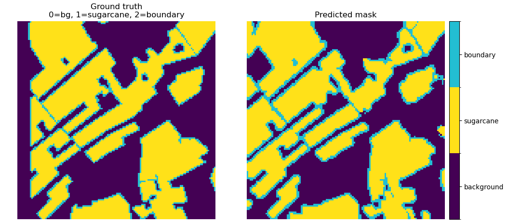
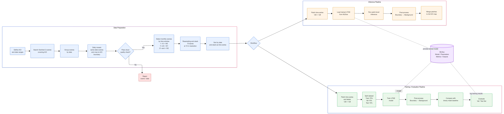
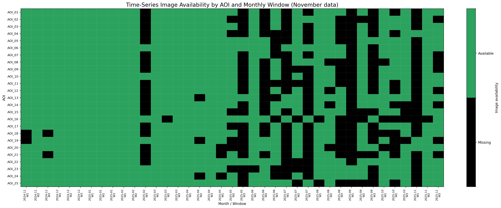
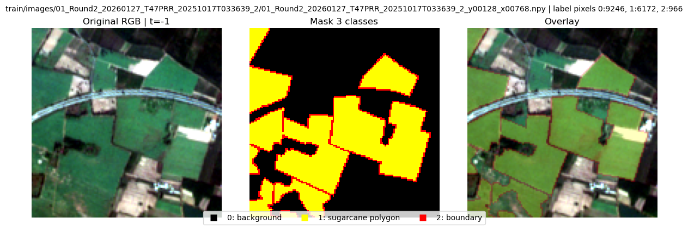
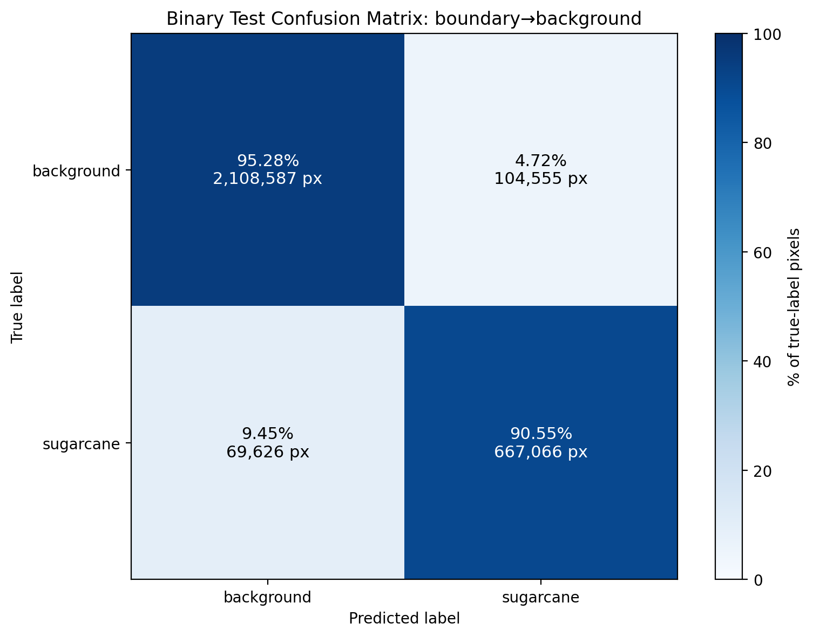
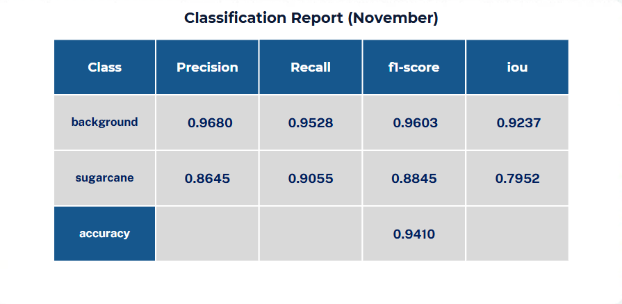
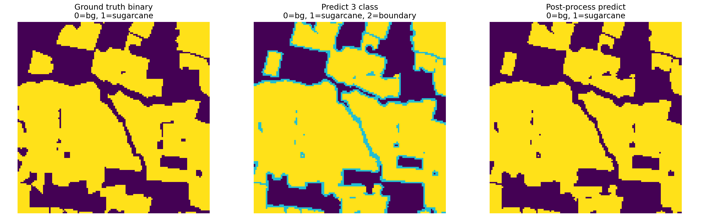

# Project Overview and Objective

This project focuses on sugarcane field segmentation in Thailand using Sentinel-2 satellite imagery. The goal is to identify sugarcane planting areas from multi-temporal satellite images that capture the growth pattern of sugarcane across its crop cycle.

The model takes Sentinel-2 satellite time-series data with 10 spectral bands as input, enabling it to capture both the spatial characteristics and seasonal growth patterns of sugarcane fields. [U-TAE](https://github.com/Many98/Crop2Seg) (U-Net with Temporal Attention Encoder) is used for semantic segmentation to produce field-level sugarcane area predictions. 

# Problem Statement

* **Cloud contamination during key growing season**
    Sugarcane is most visible during its active growth stage, but this period often overlaps with Thailand’s rainy season. As a result, Sentinel-2 satellite images are frequently affected by clouds, cloud shadows, and incomplete image coverage.

* **Loss of important field information**
    Cloud-affected images can reduce image quality and obscure sugarcane field patterns, making it more difficult for the model to distinguish sugarcane fields from surrounding areas.

* **Difficulty in separating adjacent fields**
    Sugarcane parcels are often located close to each other with irregular boundaries. Segmentation models may merge nearby fields, lose the original field shape, or predict beyond the actual field area.

* **Need for field-level segmentation**
    The task is not only to identify sugarcane areas, but also to preserve field boundaries and produce reliable segmentation outputs for agricultural area analysis.

# Data Description

The dataset consists of 25 Areas of Interest (AOIs) collected from sugarcane growing regions in Thailand. These AOIs represent different sugarcane field areas and were used as spatial samples for preparing Sentinel-2 satellite time-series data. The satellite data was collected across 13-month crop cycle periods (1 November 2024 – 30 November 2025)

For each observation date, 10 spectral bands from Sentinel-2 satellite imagery were stacked into a multi-band image, including Blue, Green, Red, Red Edge, NIR, Narrow NIR, and SWIR bands. These bands provide more information than a normal RGB image and help the model capture vegetation characteristics of sugarcane fields.

After preparing the multi-band images for each date, the images were arranged chronologically and stacked into time-series inputs. This allows the model to learn not only the spatial patterns of sugarcane fields, but also their growth changes across the crop cycle.

# Workflow / Methodology

# Data Preparation

Sentinel-2 satellite imagery was processed based on selected Areas of Interest (AOIs) before being used for model training.

* **AOI and date range definition:** Areas of Interest (AOIs) and crop cycle periods were defined to specify where and when satellite images should be collected. This step ensured that the data covered sugarcane-growing areas and captured the sugarcane growth period.

* **Sentinel-2 image search:**
Sentinel-2 satellite images covering each AOI were searched and collected based on the selected crop cycle periods. When multiple images were available for the same area and date, they were grouped together for daily image preparation.

* **Daily image preparation and AOI cropping:**
Sentinel-2 satellite images were grouped by capture date and mosaicked into a single daily image for each AOI. Each daily image was then cropped to the AOI boundary to keep only the relevant sugarcane-growing area.

* **Cloud and image-quality filtering:**
Each daily image was checked using predefined cloud-quality thresholds. Images with excessive thick clouds, cloud shadows, or thin clouds were filtered out, so only clearer and more reliable satellite data were used for the next processing steps.

* **Time-window image selection:**
To improve temporal consistency, each month was divided into three time windows: days 1–10, days 11–20, and days 21–end of month. For each window, the clearest image with the most complete AOI coverage was selected. This ensured that the time-series data represented the crop cycle more evenly over time.

* **Band resampling and multi-band stacking:**
Sentinel-2 bands with different spatial resolutions were resampled to a consistent 10-meter resolution. For each selected date, 10 spectral bands from Sentinel-2 satellite imagery were then stacked into a single multi-band image.

* **Time-series stacking:**
The multi-band images were sorted chronologically and combined into time-series inputs. This allowed the model to capture both the spatial characteristics and seasonal growth patterns of sugarcane fields. 

# Label Design

This project used a three-class label design for model training (sugarcane, boundary, and background). The boundary class was added to help the model learn the separation between adjacent sugarcane fields, which is a common challenge in agricultural segmentation.

After prediction, the boundary class was converted to the background class during post-processing. This helped prevent nearby sugarcane fields from being merged into one large region and produced cleaner field-level segmentation results.

This boundary-based label design was inspired by the [Field of the World dataset](https://fieldsofthe.world), which uses field boundary information to improve agricultural field segmentation.

# Model

This project uses [U-TAE](https://github.com/Many98/Crop2Seg) (U-Net with Temporal Attention Encoder), a deep learning model designed for semantic segmentation on satellite image time-series data.

U-TAE was selected because it can process multi-temporal satellite images and learn changes in sugarcane fields across the crop cycle. Unlike a standard image segmentation model that uses only a single image, U-TAE can use information from multiple time steps to better capture both field structure and seasonal growth patterns.

The model takes Sentinel-2 satellite time-series data with 10 spectral bands as input and produces sugarcane segmentation maps as output. Each pixel is classified into a target class, allowing the model to identify sugarcane areas at the field level.

Model performance was evaluated using segmentation metrics including Intersection over Union (IoU), F1-score, precision, and recall.

# Model Training Results

* Confusion Matrix 

* Classification Report 

* Sample Predictions on Test Set 

The model was evaluated on the test set after converting the predicted boundary class to background during post-processing. This evaluation focuses on the final binary segmentation output (sugarcane and background).

The model achieved an overall accuracy of 94.10% on the test set. For the sugarcane class, the model reached a precision of 0.8645, recall of 0.9055, F1-score of 0.8845, and IoU of 0.7952.

The confusion matrix shows that 90.55% of true sugarcane pixels were correctly predicted as sugarcane, while 9.45% were misclassified as background. This indicates that the model was able to identify most sugarcane areas in the test set, However, some errors still occurred where sugarcane pixels were missed or where field boundaries were difficult to separate.
